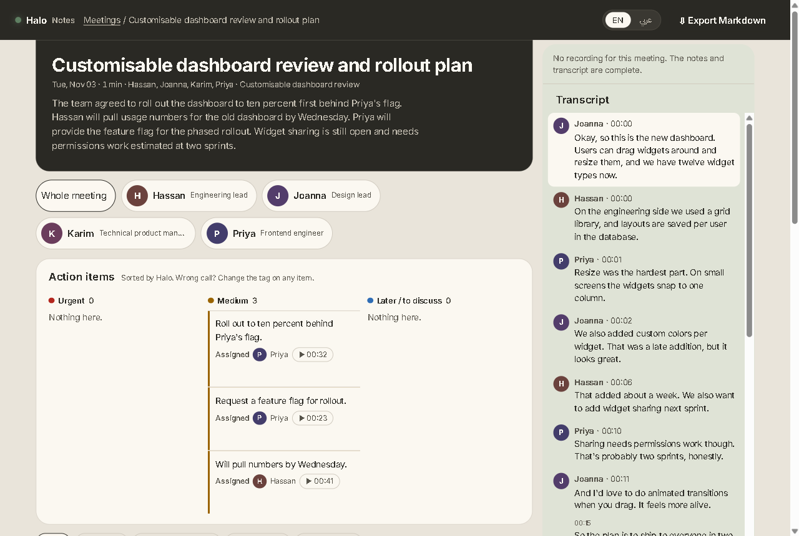
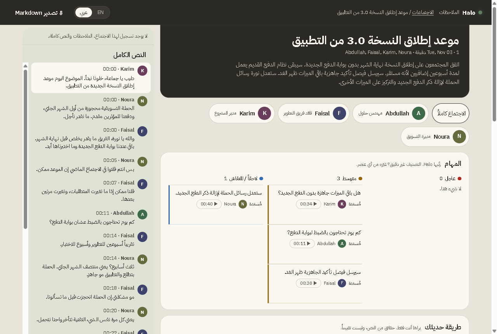
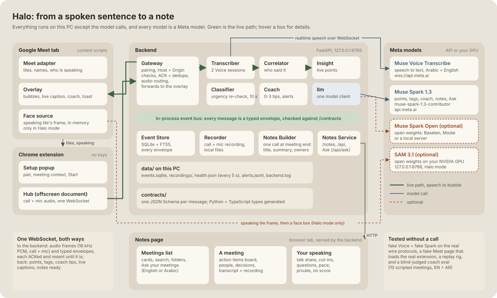

<div align="center">

# Halo

### A bilingual Arabic/English meeting copilot for Google Meet, running on Meta models.

**What matters in the meeting, on the speaker's tile, while they're still talking.**

[](https://github.com/xKarimAm/halo/actions/workflows/ci.yml)
[](#meta-models-used-and-where)
[](docs/FEATURES.md)
[](docs/INSTALL.md)
[](extension/)
[](SECURITY.md)
[](LICENSE)

[Judging in 5 minutes](#judging-in-5-minutes) · [Install](docs/INSTALL.md) · [Features](docs/FEATURES.md) · [User guide](docs/USER-GUIDE.md) · [Architecture](docs/ARCHITECTURE.md) · [Security](SECURITY.md) · [Troubleshooting](docs/TROUBLESHOOTING.md)

<br />




<sub>Notes from two of the demo meetings that <code>packaging/demo.py</code> plays through the real Meta models: English, and the same page in Arabic.</sub>

</div>

> [!IMPORTANT]
> Every AI model Halo calls at runtime is a Meta model: Muse Voice Transcribe, Muse Spark (1.3 contributor, or Spark Open when its key is set) and, optionally, SAM 3.1 on your own GPU. The [table below](#meta-models-used-and-where) names each one, its endpoint and the file that calls it.

> [!NOTE]
> Built solo by Karim for the Meta Global AI Developer Hackathon (Indie track). All code was written during the event: the first commit is Oct 30, 2026. Meta's Muse (with Wonder and Muse Spark 1.3) built the first wave of modules, then Claude Code carried the integration and live fixes; OpenCode was the backup and Gemini the research tool. Halo calls none of them at runtime ([how it was built](#how-it-was-built)).

---

Halo is built for meetings that switch between Arabic and English mid-sentence. It listens on your own PC and, a few seconds after someone says something that matters, puts it on their video tile in the language you read best.

- **Live bubbles.** A point, a question, a decision or a pushback appears as a glass bubble on the speaker's tile. Colour is urgency, and the exact words are one click away in their own script.
- **A live coach.** A side panel whispers 0 to 3 tips: a decision with no owner, a question nobody answered, someone who hasn't spoken. Alone in a call, it coaches a rehearsal.
- **Notes when the call ends.** An AI title and summary, an action items board with owners, decisions, open questions, a person-by-person view, a chat-style transcript with jumps into the recording, and Markdown export.
- **A meetings home that reads at a glance.** Every meeting is a call strip with each point at the second it was said. Urgent work has its own red tab, Halo sorts meetings by type (sprint, sales, discovery…) and you can re-sort them, archive what's done, and follow one person across meetings. The preview has a recording line that reacts to the cursor: click any decision or action and it jumps to that moment.
- **Live fact check.** When someone states a public number, Muse Spark's web search checks it and a card shows the verdict and a real source a few seconds later ("Saudi Arabia has about 35 million people, not 100 million"). Internal numbers are left alone, and every check lands in the notes.
- **A visual recap.** One press draws the meeting as a one-page sketch with Muse Image, in English or Arabic, saved next to the notes.
- **Ask your meetings.** Ask in English or Arabic ("who owns the signup numbers?") and get a short answer with the exact stored lines it came from. An Arabic question finds an English meeting and the other way round.

Everything runs on your PC: a Chrome extension plus a small Python backend on `127.0.0.1`. Nothing is hosted and there are no accounts. Only the model calls leave your machine. The full list, with what has been checked live and what only by tests, is in [Features](docs/FEATURES.md).

## Judging in 5 minutes

1. Install it: `powershell -ExecutionPolicy Bypass -File .\setup.ps1` asks for your Meta Model API key (hidden), builds the extension and starts Halo ([Install](docs/INSTALL.md)).
2. In a **second** PowerShell window in the `halo` folder: `uv run python packaging/demo.py` plays three scripted meetings (English, Arabic, mixed) through the real Meta models. No call needed; it takes about 3 minutes and prints a notes link per meeting.
3. Open http://127.0.0.1:8765 (setup already started the backend; otherwise run `uv run halo`). You get the meetings list, the notes, the action items board and the speaking panel. Try **Ask your meetings** at the top, for example "Who owns the signup numbers?" or, in Arabic, "ماذا قررنا بشأن موعد إطلاق النسخة 3.0؟".
4. Live: load the extension (it pairs itself), join a Google Meet call with a headset and press **Start** ([steps 5 and 6](docs/INSTALL.md#5-load-the-extension-and-pair)).

No key? The tests need none: `uv run pytest backend contracts -q` and `npm --prefix extension test`.

## Quick start

You need **Google Chrome**, **Git**, **Node.js 22+** (to build the extension), a **headset** and a **Meta Model API key**. The setup script installs [uv](https://docs.astral.sh/uv/) (which brings Python 3.12) if you don't have it. In PowerShell:

```powershell
git clone https://github.com/xKarimAm/halo.git
cd halo
powershell -ExecutionPolicy Bypass -File .\setup.ps1
```

It asks for your key (typed hidden, saved only in the git-ignored `.env`), builds the extension, opens its folder, and starts the backend. Then in Chrome: `chrome://extensions`, turn on **Developer mode**, **Load unpacked**, pick the folder it opened (`extension\.output\chrome-mv3`). Click the Halo icon: the pill says **Connected**, because the extension pairs with the backend on its own. macOS and Linux: `sh setup.sh`.

The [install guide](docs/INSTALL.md) has the same steps by hand with a check after each one, plus Spark Open, Halo mode, updating and uninstalling.

## Meta models used and where

| Model | Exact id | Endpoint | Called from | What it does |
|---|---|---|---|---|
| Muse Voice Transcribe (realtime) | `muse-voice-transcribe-1.0` | `wss://api.meta.ai/v1/asr/realtime` | `backend/halo/transcriber/` (`protocol.py` builds the handshake, `transport.py` holds the socket; the URL is in `rig/fakes/config.py`) | Speech to text. Two sessions per meeting: the call audio in `DIARIZATION` mode (who said what) and your mic in `ENDPOINTING` mode. Language bias Arabic + English. |
| Muse Spark Open (open weights, Baseten by default; Modal or a local server through `.env`) | `meta-models/muse-spark-open-1026` | `https://inference.baseten.co/v1` | `backend/halo/llm/llm.py` (the one shared model client) | The first choice for every text call when its key is set: live points (`backend/halo/insight/`), urgency/kind tags (`backend/halo/classifier/`), the live coach (`backend/halo/coach/`), the end-of-meeting notes (`backend/halo/notes_builder/`) and Ask your meetings (`backend/halo/notes_service/ask.py`). |
| Muse Spark 1.3 web search (contributor) | `muse-spark-1.3-contributor`, `web_search` tool, Responses API | `https://api.meta.ai/v1/responses` | `backend/halo/fact_check/`, `llm.py` `search_json` | Live fact check: a point with a number, at most 20 calls a meeting |
| Muse Image 1.0 | `muse-image-1.0`, `image_generation` tool | `https://api.meta.ai/v1/responses` | `backend/halo/notes_service/`, `llm.py` `generate_image` | Visual recap, only when you press the button; saved, so one image per meeting at most |
| Muse Spark 1.3 (contributor) | `muse-spark-1.3-contributor` | `https://api.meta.ai/v1` | `backend/halo/llm/llm.py` | Runs every text call when no Spark Open key is set (the simplest setup: one Meta key). With a Spark Open key, it is the per-call failover when Spark Open takes over 4 s, fails twice (bad JSON, HTTP 429 or 5xx) or rejects the key; after 30 s Spark Open gets tried again. Same five callers as above. |
| SAM 3.1 (open weights, optional) | Meta's SAM 3.1 weights via the `unsloth/sam3.1` Hugging Face mirror (`transformers` `Sam3Model`) | `http://127.0.0.1:8766/faces` (your own GPU) | `packaging/sam_worker.py`, called by `extension/src/face_detector/sam.ts` | Halo mode: finds the speaker's face in their tile so the name sits above the head. Frames stay in memory on your PC. Without the worker, Frame mode. |

The Chrome extension calls no models itself; it talks to the local backend and, in Halo mode, to the local SAM worker.

## How it works



1. The extension captures the call audio and your mic, and reads Meet's page for tiles, names and who is highlighted as speaking.
2. Both go over one local WebSocket to the backend. Every message is a typed envelope, validated against `contracts/` and acknowledged.
3. Muse Voice turns the audio into turns, and the correlator matches each turn to the right person on screen.
4. Spark reads the attributed turns and returns points; a second pass re-checks urgency; the coach reads the meeting so far.
5. When the meeting ends, Spark writes the notes in one schema-checked call. Everything is stored in local SQLite and served as the notes page.

The [architecture page](docs/architecture/index.html) (open it locally) explains why each part exists and what was left out on purpose. [ARCHITECTURE.md](docs/ARCHITECTURE.md) walks one meeting end to end.

**What was hard.** Meet's speaking highlight trails the audio, so the correlator uses a lag window and locks a speaker after 3 agreeing turns. Points have to land while they still matter, so they trigger at the speaker's pause rather than the end of the sentence. The coach has to know when to stay quiet: I tuned it in blind-judged loops on 10 scripted meetings (`backend/halo/coach/eval/`). Spark wrote the tips, and a separate Claude agent, a development tool and never part of Halo, scored old against new without knowing which was which. In my last round, invented owners and dates went from 4 to 1 in my runs (the eval output is not in the repo).

## What's in here, and why

| Path | Why it exists |
|---|---|
| [`contracts/`](contracts/) | The only thing modules share: one JSON Schema per message, with the Python and TypeScript types generated from it. A mismatch fails CI instead of a live call. |
| [`backend/halo/`](backend/halo/) | The FastAPI backend, one folder per module (Gateway, Transcriber, Correlator, Insight, Classifier, Coach, Notes Builder, Notes Service, Recorder, Event Store). Modules talk only over the event bus; `uv run lint-imports` fails the build if one imports another. |
| [`extension/`](extension/) | The Chrome extension (WXT + TypeScript): setup popup, capture, Meet adapter, overlay. It holds no keys and calls no models. |
| [`notes-page/`](notes-page/) | The notes page, plain HTML/CSS/JS with no build step, so the backend serves it as files. |
| [`packaging/`](packaging/) | `demo.py` (three meetings without a call), `sam_worker.py` (the optional SAM 3.1 worker) and the release check. |
| [`rig/`](rig/) | The offline test rig: fake Voice and Spark servers on the real wire protocols, a fake Meet page that loads the real extension, and a replayer. It is how the pipeline is tested without a call or a key. |
| [`docs/`](docs/) | Install, features, user guide, troubleshooting, architecture and [DECISIONS.md](docs/DECISIONS.md), the locked decisions with their reasons. |
| `AGENTS.md`, `CLAUDE.md`, `.agents/`, `docs/PLAN.md`, `docs/agents/`, per-folder `PLAN.md` / `STATE.md` | Instructions for the coding agents I built Halo with: the build plan, the issue conventions, and per module a plan and a file map, so an agent reads one folder instead of the whole repo. |
| `opencode.json`, `.claude/settings.json` | Coding-tool config. OpenCode points at Muse Spark 1.3 on api.meta.ai through its OpenAI-compatible adapter (the npm name `@ai-sdk/openai` is the adapter, not OpenAI's models); `.claude/` holds Claude Code's permissions. Halo never loads either. |
| [`docs/ui/`](docs/ui/) | The design sources the UI was built from: the notes page design (`notes-v2.html`), overlay mocks, urgency drafts and screenshots. |
| `docs/SUBMISSION_WRITEUP.md`, `docs/demo/feature-log.md` | The draft for the hackathon portal, and the feature log with commits for the demo video. |
| `conftest.py`, `.ignore`, `.gitattributes`, `.github/pull_request_template.md` | Puts the repo root on pytest's import path; keeps lockfiles out of code search; fixes line endings; the PR checklist. |
| [`.github/workflows/ci.yml`](.github/workflows/ci.yml) | Runs on every PR: contracts, codegen drift, Python tests, Ruff, import lanes, mypy (report only), the extension's typecheck and tests, and the notes page's render tests in Chromium. |

## What's deliberately not here

| Not here | Why |
|---|---|
| A hosted server, accounts or a cloud database | A meeting tool hears private calls. Keeping it on `127.0.0.1` means nothing to sign up for and nothing of yours on someone else's server. |
| Any non-Meta model at runtime | The hackathon asks for Meta models, so Halo has one model client (`llm.py`) and no other AI SDK. An earlier MediaPipe face detector was removed for this reason; SAM 3.1 replaced it. |
| An embedding model or vector database for Ask | It would add a non-Meta model. Ask expands the question into English and Arabic keywords with Spark, scores stored passages, and has Spark answer from the top ones with citations. |
| Video in the recording | The recording is call audio and your mic only: smaller, and nobody's face is stored. |
| Posting into the Meet chat | Halo never writes into the call. The consent notice is copied for you to paste. |
| A Chrome Web Store listing | This is a hackathon build, loaded unpacked. The manifest key is pinned, so the extension id (which the backend's Origin check expects) is the same on every machine. |
| `CONTRIBUTING.md` | Solo hackathon project. Issues are welcome; [SECURITY.md](SECURITY.md) says how to report a security problem. |

## Tech stack

| Layer | What | Why this |
|---|---|---|
| Runtime AI | Muse Voice Transcribe 1.0 (realtime ASR), Muse Spark Open 1026 on Baseten with Muse Spark 1.3 contributor as failover, Muse Spark web search, Muse Image 1.0, SAM 3.1 (optional, local GPU) | Meta models only, one shared client (`backend/halo/llm/llm.py`), per-call failover in 4 s |
| Backend | Python 3.12, FastAPI + Uvicorn on `127.0.0.1:8765`, `websockets`, an in-process event bus, SQLite (FTS5) | One process, one port, no server to host; every module talks over the bus only |
| Contracts | JSON Schema per message, generated Pydantic and TypeScript types (`contracts/codegen.py`) | A shape mismatch fails CI, not a live call |
| Extension | Chrome MV3, WXT, TypeScript, an offscreen document for the socket and capture, `tabCapture` + `getUserMedia` | Captures the call and your mic without a desktop app; holds no keys |
| Notes page | Plain HTML, CSS and JavaScript (no build step), SVG for the recording line, the View Transitions API | The backend serves it as files; nothing to compile |
| Tests | pytest, Vitest + happy-dom, Playwright (notes page and a Fake Meet page that loads the real extension), Ruff, import-linter, mypy (report) | The whole pipeline runs offline against fake Voice and Spark servers on the real wire protocols |
| Tooling | uv (locked Python deps), npm, GitHub Actions CI | `uv.lock` and `package-lock.json` pin every version |

## How it was built

Halo was built in six days by one person directing several coding agents in parallel, each in its own folder ("lane"), talking through GitHub issues ([AGENTS.md](AGENTS.md), [DECISIONS.md §6](docs/DECISIONS.md)).

| Tool | What it did |
|---|---|
| **Muse** (Meta's coding agent) **with Wonder** | Built the hardest browser modules in the first wave: the test rig, hub and capture, face detector and overlay. These runs used a large share of the Meta API credit: the plan set aside about $100 of the $148 for them. |
| **Muse** (subscription) | Wave 0 (contracts, CI), then the backend core: bus, model client, gateway, event store, transcriber, correlator, insight; the classifier, notes builder, notes service and recorder were planned for it too. |
| **Muse on Muse Spark 1.3** (contributor mode, on the Meta API key) | The setup panel, Meet adapter, frame source and the first notes page. |
| **Claude Code** (Anthropic) | Oct 30: the architecture, decisions and module plans with me. From Oct 31: merging the Muse modules and the live-call fixes, then the coach, the notes page redesign, Ask your meetings, automatic pairing, the meetings home, docs and reviews. Its commits carry a `Co-Authored-By: Claude` line. |
| **OpenCode** on Muse Spark 1.3 (`opencode.json`) | The backup harness for the Muse windows. |
| Gemini | Research only. |

In the history, every commit without a Claude trailer is from Oct 30–31 (1 and 55): that first Muse wave. Check with `git log --no-merges --invert-grep -i --grep="co-authored-by: claude" --format=%ad --date=short | sort | uniq -c`. None of these tools is called by Halo at runtime, and the repo has no Anthropic, OpenAI or LangChain package. A separate Claude agent judged the coach eval blind; it never runs inside Halo.

`git log` shows the whole history from Oct 30, 2026. No code came from older projects.

## License

MIT, see [LICENSE](LICENSE).
