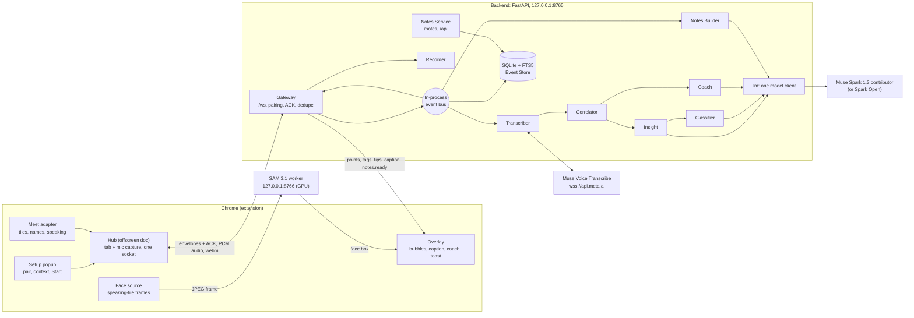

# Halo architecture

There are two processes on your PC, plus one optional worker:

- **The Chrome extension** (WXT + TypeScript) captures audio, reads Meet's page and draws the overlay.
- **The backend** (one FastAPI process, Python 3.12) holds every model call, the database and the notes page.
- **The SAM 3.1 worker** (optional) finds faces for Halo mode on your GPU.

The extension holds no keys and calls no models. The as-built diagram is [`architecture/halo-architecture.svg`](architecture/halo-architecture.svg), explained on [`architecture/index.html`](architecture/index.html); the Oct 30 planning diagram is [`architecture/halo-v2-final.drawio`](architecture/halo-v2-final.drawio). The locked decisions are in [`DECISIONS.md`](DECISIONS.md).

## One meeting, end to end

1. **Start.** The popup tells the hub to start. The hub mints a `meeting_id` (UUID) and sends `meeting.started` and `meeting.context` over its one WebSocket. Every message is a CloudEvents envelope that the Gateway validates against `/contracts`, dedupes by id and acknowledges.
2. **Audio.** The hub streams two 16 kHz PCM streams as binary frames: the call (tab) and your mic. The Transcriber opens two Muse Voice sessions: the call in diarization mode (who is talking) and your mic in endpointing mode (that's "you"). Live words go to the overlay as `transcript.partial`. Finished turns become `transcript.final`.
3. **Who said it.** The Meet adapter reports tiles, names and Meet's speaking highlight. The Correlator joins those with the transcript, using a lag knob because Meet's highlight trails the audio. It emits `turn.attributed`: final text plus tile and name.
4. **Points.** Insight sends batches of attributed turns to Spark and publishes `points.upsert` (kind, urgency, the speaker's exact quote). The Classifier re-checks kind and urgency every 10 s in one batched call (`tags.set`). A user re-tag always wins.
5. **Coach.** The Coach reads the meeting so far. It calls Spark when new words arrive (at most every 8 s) or after a 15 s silence, then filters the reply: no repeated alert, no talk-over alert when you're alone. It publishes `coach.tips`.

   **Fact Check.** Every point and pushback goes to Spark with the `web_search` tool on the Fact Check's own loop (decisions and actions too when reference notes are attached), at most 60 calls a meeting. Internal claims come back `skip` without a search. `supported` and `disputed` go out as `claim.checked` to the Overlay and the store.
6. **Overlay.** The Gateway forwards points, tags, tips, captions and `notes.ready` to the extension. The overlay draws them on the right tile with DOM `textContent` only (Meet enforces Trusted Types).
7. **End.** Stop, leaving the call or closing the tab sends `meeting.ended`. A dead socket triggers it after a 60 s grace. The Notes Builder reads the meeting from SQLite and makes one schema-checked Spark call: title, summary, action items with owners and urgency. It publishes `notes.ready`. If the call fails twice, it falls back to the live points.
8. **Notes.** The Notes Service serves the notes page and its JSON API from the same SQLite file. SQLite's FTS5 indexes transcripts and points for search. The Recorder saves the mixed recording to `data/recordings/` so each item can jump to its moment.

9. **Ask your meetings.** `POST /api/ask` (`backend/halo/notes_service/ask.py`):
   - Spark turns the question into English and Arabic keywords.
   - Every meeting's AI summary, points and transcript lines are scored by keyword hits. Arabic is normalised: no diacritics, one alef, no leading article.
   - Spark answers from the top passages and cites them by number. The citations shown are the stored passages, so a quote can't be made up.
   - There is no embedding model, because the runtime stays Meta-only.

## Models and endpoints

| Model | Endpoint | Called from | Job |
|---|---|---|---|
| Muse Voice Transcribe 1.0 | `wss://api.meta.ai/v1/asr/realtime` | `backend/halo/transcriber/` | Speech to text, Arabic + English, two sessions per meeting |
| Muse Spark 1.3 contributor | `https://api.meta.ai/v1` (`muse-spark-1.3-contributor`) | `backend/halo/llm/llm.py` | Every text call (points, tags, coach, notes, Ask) when no Spark Open key is set; otherwise failover |
| Muse Spark Open (open weights) | `https://inference.baseten.co/v1` (`meta-models/muse-spark-open-1026`), or Modal / a local server via `HALO_PRIMARY_*` | `backend/halo/llm/llm.py` | First choice for text calls when its key is set |
| SAM 3.1 (open weights) | `http://127.0.0.1:8766/faces` (`packaging/sam_worker.py`) | `extension/src/face_detector/sam.ts` | Halo mode face boxes, optional |

There is one model client: `backend/halo/llm/llm.py` handles every text call. It speaks OpenAI-compatible chat completions and always sends a JSON schema, then checks the reply against that schema locally. A fast failure gets one retry on the same engine; after that the call moves to the other engine. Every result records which engine answered.

## Why it holds up

- **Typed contracts first.** `contracts/` holds one JSON Schema per message type, and the Python and TypeScript types are generated from them. Model output is validated too.
- **Modules only talk over the bus.** `app.py` is the only file that imports modules, and `uv run lint-imports` fails the build if one module imports another.
- **One of each.** One socket per hub, one producer per audio stream (the newest socket wins), one Voice session per stream, one backend per port. A repeat Start replaces the running one instead of stacking a second.
- **Everything is local and inspectable.** Health is rewritten to `data/health.json` every 5 s, and every warning lands in `data/alerts.jsonl` (see [troubleshooting](TROUBLESHOOTING.md)).
- **Tests at every layer.** There are unit tests per module, an ACK kit for the socket rules, a replay rig with fake Voice and fake Spark servers on the real wire protocols (`rig/`), a fake Meet page that loads the real extension in Playwright, and a blind-judged coach eval (`backend/halo/coach/eval/`, run by hand with a Meta key; a Claude agent is the judge, at development time only).
